

  <h1 align="center"><strong>New Orleans Yelp Restaurants Project</strong></h1>
  <h3 align="center">By: Joseph Ko</h3>

<body>

# __Main Research Question__
> __Where can someone find the best restaurants for New Orleans cuisine (Cajun/Creole, Po' Boys, Gumbos, etc.) 
in New Orleans, and which geographic area is best for finding them?__

# __Short Executive Summary__
Executive summary:
TBD

# __Data sources and cleaning decisions__
### 1. Problems Encountered

The primary obstacle encountered when working with the Yelp Academic Dataset—specifically yelp_academic_dataset_review.json—was severe memory saturation (RAM depletion). Standard JSON parsing functions in R, such as jsonlite::fromJSON(), attempt to load an entire file structure into memory at once. Because the reviews file contains millions of rows of dense text data, this immediately exceeded available RAM, causing R sessions to freeze and crash. Additionally, the dataset contained multiple metadata columns that were irrelevant to the immediate analysis goal, which drastically increased import times and disk space usage.
A different challenge arose with yelp_academic_dataset_business.json. While significantly smaller than the review dataset, it contained heavily nested structural elements (such as operational hours and business attributes). Importing it without flattening would preserve complex data structures that do not map cleanly to standard data frames, complicating downstream data manipulation and flat-file exports.

### 2. Strategy and Implementation

To overcome these computing and structural constraints, a multi-tiered data pipeline was engineered to process, filter, flatten, and compress both datasets efficiently:

### Phase A: Chunked Streaming and Filtering (Reviews Dataset)
- __Chunked Processing (Streaming):__ Instead of parsing the massive review file simultaneously, the jsonlite::stream_in() function was paired with a custom callback handler. By initializing a pagesize = 50000, the dataset was divided and read in manageable blocks.
- __Column Selection On-The-Fly:__ Within the callback loop, memory footprint reduction was prioritized by immediately subsetting each chunk to retain only five essential columns: review_id, business_id, stars, date, and text. Unused attributes were discarded dynamically prior to serialization, ensuring R only held a tiny fraction of the data in RAM at any given moment.
- __Intermediary Disk Storage:__ To safely persist the data without risking a memory crash, the processed chunks were appended to a flat file on disk (yelp_reviews_subset.csv). Quotation marks within the review strings were strictly managed using the qmethod = "double" parameter to prevent formatting failures caused by unescaped user text.

### Phase B: Flattening and Direct Conversion (Business Dataset)
- __Nested Structure Flattening:__ Because the business dataset fits within standard RAM limits, it was processed as a single stream but passed through a flattening parameters framework (flatten = TRUE). This automatically unpacked nested lists (e.g., parking options, price ranges, and daily hours) into discrete, independent tabular columns.
- __Multi-Format Export:__ The flattened business data frame was written directly to disk as a structured flat file (yelp_businesses.csv) using the highly optimized vroom::vroom_write() function to ensure clean formatting across complex column attributes.

### Phase C: Binary Serialization and RDS Compression
- __Binary Compressing (.rds):__ To optimize long-term storage and eliminate future text-parsing overhead, both the filtered review dataset and the flattened business dataset were converted into R's native binary format using saveRDS().
- __Workspace Optimization:__ The resulting .rds files drastically reduced file sizes on disk through built-in compression. Furthermore, this approach eliminated the need to re-parse raw JSON or CSV files in future sessions. The clean datasets can now be loaded into R almost instantaneously using readRDS(), providing a fast, stable, and highly optimized environment for downstream analysis.

# __Selected restaurant categories and geographic system__
### Selected restaurant categories:

- Cajun/Creole
- Seafood
- Sandwiches

### Selected geographic system:

- I selected __census block groups__ as my main geographic system for the main analysis. The main
reason why is because I find it easier to create a more informative map out of this geographic system.

# __Important tables__
### Census Tract Tables
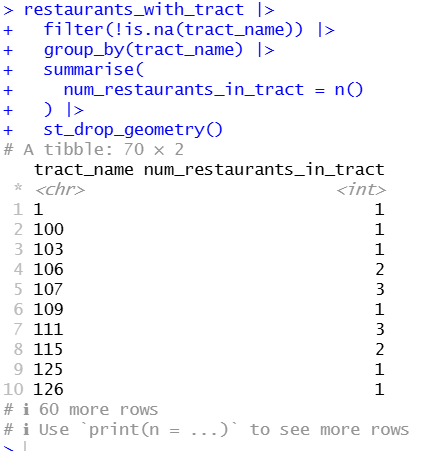
  
*Table showing number of restaurants in each census tract*
  
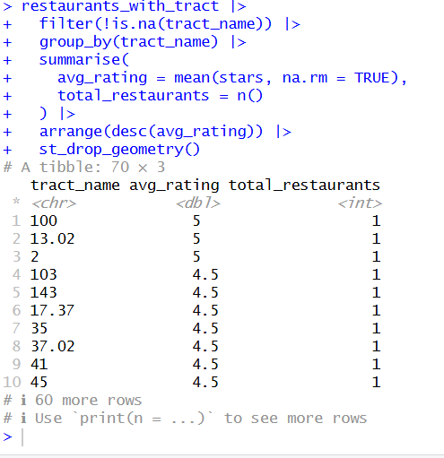
  
*Table showing average business rating for all businesses in each census tract*
  
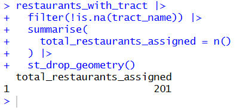
  
*Table showing total count of all assigned businesses in census tracts*
  
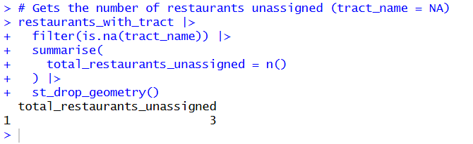
  
*Table showing all businesses not assigned to any census tract (or NA)*
  
[Download or view the full dataset](figures/fewest_in_ctracts.csv)
  
*Csv file containing information on restaurant distributions across each census tract*
  

### Census Block Group Tables
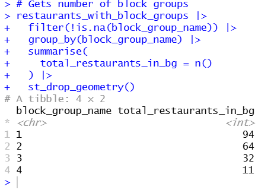
  
*Table showing number of restaurants in each census block group*
<  
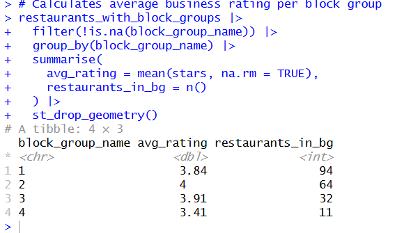
  
*Table showing average business rating for all businesses in each census block group*
  
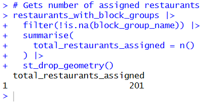
  
*Table showing total count of all assigned businesses in census block group*
  
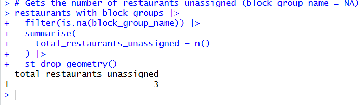
  
*Table showing all businesses not assigned to any census block group (or NA)*
  
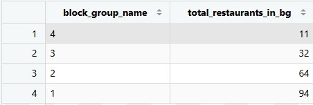
  
*Table showing information on restaurant distributions across each census block group*
  

### Comparison Table
[Open Comparison Table](figures/comparison_table.html)
  
*Html file containing a table that compares each geographic system used in this analysis*
  

# __Static graphs and maps__
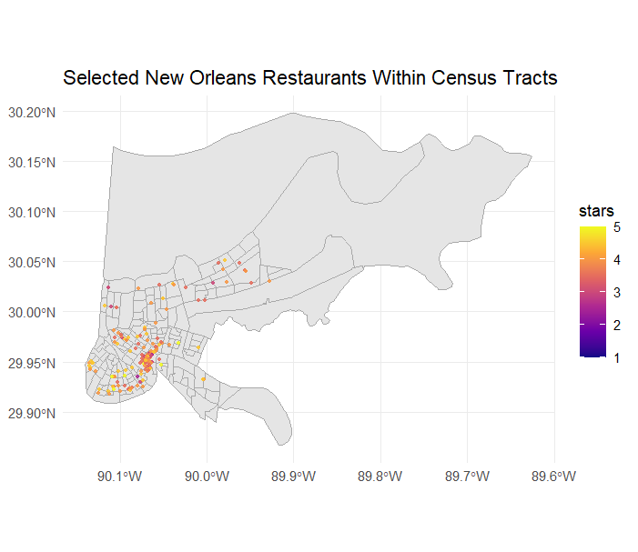
  
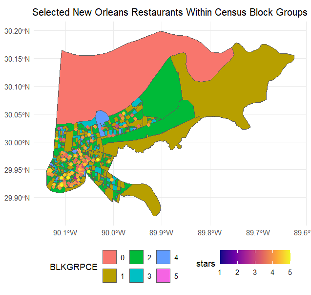
  
*Note: BLKGRPCE stands for the block group's name*
  

# __Main Conclusions & Limitations__
TBD

# __Links to code in repository__
[import.R](R/import.R)
  
[clean.R](R/clean.R)
  
[analysis.R](R/analysis.R)

</body>